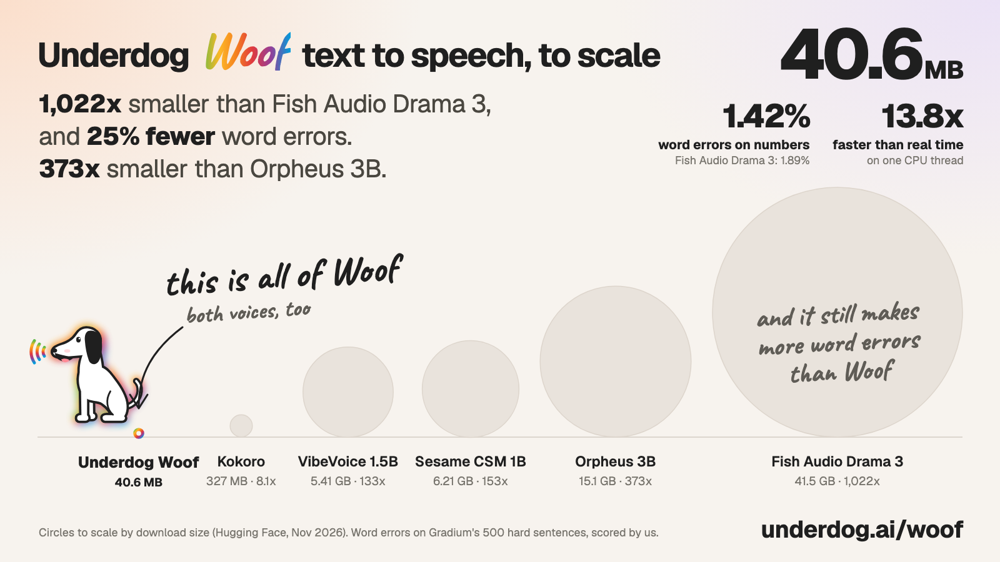

# Underdog Woof


- **1,022x smaller than Fish Audio Drama 3** (41.5 GB), with **25% fewer word errors**
- **1.42% word error rate** on [Gradium TTS Hard Cases](https://huggingface.co/datasets/gradium/tts-hard-sentences-202610) (English, Mira)
- **13.8x faster than real time on one CPU thread** (Juno), with no GPU, server or API key
- **40.6 MB** for the whole model, both voices included, and 402 MB of memory at peak while it runs (Juno)

Underdog Woof is a small English text-to-speech model with two voices: Juno and Mira. It reads phone numbers, dates,
prices and codes the way people say them, and it runs on a laptop CPU with nothing but numpy, from a single 40.6 MB
file. Try it in your browser at [underdog.ai/woof](https://underdog.ai/woof).

## Listen

Each voice reads "Please call me back at 415-555-0199 before 5:30 p.m. on Friday." (seed 1).

| Voice | |
|---|---|
| Juno (default) | <audio controls src="https://huggingface.co/ConwayResearch/Underdog-Woof/resolve/main/samples/juno_1.wav"></audio> |
| Mira | <audio controls src="https://huggingface.co/ConwayResearch/Underdog-Woof/resolve/main/samples/mira_1.wav"></audio> |

More clips are in the `samples` folder, listed below.

## One voice or two

Woof comes in two sizes. This repo is the two-voice model. The one-voice model is the one that runs in your browser at
[underdog.ai/woof](https://underdog.ai/woof).

| | One voice | Two voices (this repo) |
|---|---|---|
| Download | 31.7 MB | 40.6 MB |
| Peak memory, one CPU thread | 852 MB | 402 MB (Juno) |
| Word error rate, Gradium TTS Hard Cases (English) | 2.06% | 1.42% (Mira) |
| Speed on one Apple M5 Max CPU thread | 18x real time | 13.8x real time (Juno) |

The one-voice speed is plain PyTorch with its int8 weights at the default 16 steps; the two-voice speed is this repo's
numpy runtime. Fish Audio Drama 3, for scale, is a 41.5 GB download and gets 1.89% wrong.

## How Woof compares

Word error rate on Gradium TTS Hard Cases (English, 500 sentences), every model run and scored by us the same way, each
in its best-scoring voice. Lower is better.

| Model | Runs | Download | Word error rate | Woof's errors are lower by |
|---|---|---|---|---|
| **Underdog Woof, two voices (Mira)** | **your CPU** | **40.6 MB** | **1.42%** | |
| Fish Audio Drama 3 | cloud API | 41.5 GB open weights | 1.89% | 25% |
| Underdog Woof, one voice | your CPU or browser | 31.7 MB | 2.06% | |
| Phonon 31m | on device | 55.1 MB | 2.16% | 34% |
| Deepgram Flux TTS | cloud API | not public | 2.39% | 41% |
| Deepgram Aura-2 | cloud API | not public | 2.43% | 42% |
| Microsoft MAI-Voice-2.1 Flash | cloud API | not public | 2.51% | 43% |
| Fish Audio S2.1 Pro | cloud API | not public | 2.53% | 44% |
| Microsoft MAI-Voice-2.1 | cloud API | not public | 2.64% | 46% |
| Qwen Audio 3.0 TTS Plus | cloud API | not public | 2.74% | 48% |
| Mistral Voxtral 3 TTS | cloud API | not public | 2.91% | 51% |
| MiniMax Speech 2.8 Turbo | cloud API | not public | 4.63% | 69% |
| MiniMax Speech 2.8 HD | cloud API | not public | 4.88% | 71% |
| Kokoro 82M | on device | 327 MB | 5.17% | 73% |
| ByteDance Seed Audio 1.0 | cloud API | not public | 6.50% | 78% |
| ElevenLabs Flash v2.5 | cloud API | not public | 6.63% | 79% |
| Pocket TTS | on device | 219 MB | 8.07% | 82% |
| Supertonic 3 | on device | 398 MB | 8.81% | 84% |
| Kitten Nano 0.8 | on device | 27.6 MB | 9.81% | 86% |
| Qwen3-TTS 1.7B | on device | 4.54 GB | 11.99% | 88% |

Kitten Nano 0.8 is the only smaller download, and it gets 9.81% of words wrong: nothing we tested is both smaller and
more accurate than Woof. Transcripts by qwen3.8-omni-flash, word errors counted by gemma-4-31b-it. Download is the
smallest official set of weights each model needs to run, from its Hugging Face repo in November 2026 (Phonon 31m: the
4-bit GGUF; Kitten Nano: the int8 ONNX plus voices; Pocket TTS: the English model; Qwen3-TTS: the model plus its speech
tokenizer). Cloud-only models don't publish a size.

**Liquid AI LFM3-Audio-2B** (1.21 GB, 4-bit GGUF) gets **20.1%** of words wrong (747 of 3,718) in a separate run of the
same 500 sentences. Liquid publishes no word error rate for its speech, and qwen3.8-omni-flash is an API we couldn't use
for that run, so its transcripts are by Whisper large-v3, with errors still counted by gemma-4-31b-it. As a check, Kokoro
scored 4.29% that way against 5.17% above, so LFM3-Audio-2B's number on the setup above is likely a little higher, not
lower. It was run in BF16 with the settings on its model card (an American English female voice, one seed per sentence); 1.21 GB is its smallest official download.



## Results by voice

All numbers are for the files in this repo, run exactly as `python -m underdog_woof` runs them.

| | Juno | Mira |
|---|---|---|
| Word error rate, Gradium TTS Hard Cases (English) | 1.53% | 1.42% |
| Word errors | 67 in 4,371 | 62 in 4,379 |
| Speed on one Apple M5 Max CPU thread | 13.8x real time | 7.2x real time |
| Peak resident memory | 402 MB | 601 MB |

Speed is the median of three rounds over 200 everyday sentences on one CPU thread of an Apple M5 Max.

## Usage

```bash
pip install numpy
hf download ConwayResearch/Underdog-Woof --local-dir underdog-woof
cd underdog-woof
python -m underdog_woof "Your order ships on March 3rd. Call 415-555-0199 with questions." -o hello.wav
python -m underdog_woof "Your order ships on March 3rd. Call 415-555-0199 with questions." --voice mira -o mira.wav
```

```python
from underdog_woof import Woof

tts = Woof(voice="mira")   # "juno" (default) or "mira"
audio = tts("Hey! Thanks for calling. How can I help you today?", seed=0)   # float32 mono, 24 kHz
tts.save("hello.wav", audio)
```

Give Woof the text as you would write it. A built-in rule-based normalizer rewrites numbers, dates, times, money,
codes and symbols the way people say them, and respells hard names from a lexicon. It needs nothing beyond the
standard library. Pass `normalize=False` to `Woof()` if you'd rather do this yourself.

Long text is split into sentences, and a sentence over 120 characters is split again at its commas, semicolons or
dashes. Each piece is checked as it's made. If it runs far too long for its text or has a second or more of silence in
the middle, Woof draws it again, up to three more times, and keeps the best take. The results above were measured with
these settings, one seed per sentence. Pass a `seed` to get the same audio for the same text every time.

## Samples

The `samples` folder has three clips per voice, each made with the seed shown:

- `juno_0.wav`, `mira_0.wav` (seed 0): "Your order ships on March 3rd, and the tracking code is QX-4471."
- `juno_1.wav`, `mira_1.wav` (seed 1): "Please call me back at 415-555-0199 before 5:30 p.m. on Friday."
- `juno_2.wav`, `mira_2.wav` (seed 2): "The committee, which had met every Tuesday since the spring of
  2019, finally agreed that the budget would need a second review before anyone could sign it, and that the review
  should be public."

## Model

Woof makes 24 kHz mono audio. Both voices are stored in the one weights file, and its audio decoder is adapted from
Kyutai's Mimi codec.

| Part | Parameters |
|---|---|
| Speech model | 22.95M |
| Audio decoder | 15.3M |
| Total | 38.24M |

## License

Woof is free for non-commercial use, with credit. Commercial use needs a license. The full terms are the
[Underdog Non-Commercial License 1.0](LICENSE).

- **Free** for personal projects, research, teaching and non-profits, including publishing what Woof makes.
- **Credit Underdog.** Put "Underdog Woof" or "underdog.ai" in the title or description of anything you publish with
  its audio, and show "Voice by Underdog Woof" in any app or product that uses it.
- **Commercial use needs a license.** Using Woof or its audio in a paid product, an ad, a monetized video, a company's
  work or anything else that earns money needs a commercial license from Underdog: write to license@conway.tech.
- **No training on Woof.** Don't use Woof or its audio to train, fine-tune or distill another model that makes speech
  or audio.
- **Free inside Underdog.** Using Woof through underdog.ai and Underdog's own apps is always free.

The audio decoder is adapted from Kyutai's Mimi, and the training data includes LibriTTS-R and Emilia-YODAS, all CC-BY
4.0. The attributions are in [NOTICE](NOTICE).
# underdog_wof
